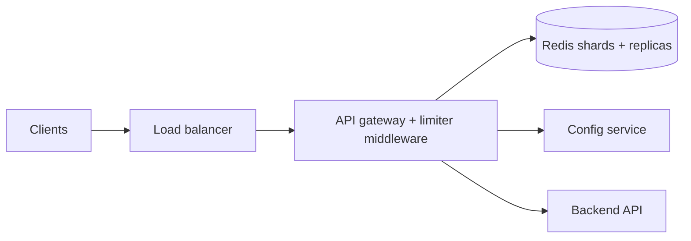

# Rate Limiter - design

## Requirements

Functional: limit each client (per API key, per user and per IP) to N requests per time window; requests over the limit are rejected with HTTP 429. Limits are configurable per endpoint and per pricing tier. The limiter must work across a distributed cluster: multiple API servers share one view of each client's usage. Out of scope: billing, long-term usage analytics.
Non-functional: the limiter adds under 2 ms of latency overhead, is accurate within a few percent, and must not reduce API availability (if the limiter fails we fail open). Scale target: 1 million requests per second across 5 million active clients. Priority: low latency and availability over perfect accuracy.

## Estimation

Traffic: 1,000,000 requests per second (QPS) at peak, so 1M limiter checks per second, each one a read-modify-write. Read/write ratio is 1:1 because every check updates state.
Storage: state per client is a counter plus a timestamp, about 64 bytes. 5M clients x 64 bytes = 320 MB, so everything fits in memory (RAM) on one Redis node; we shard for throughput not size. One Redis node handles roughly 100,000 ops/s, so ~10 shards plus headroom for 2x peak growth.
Bandwidth: 1M checks x 100 bytes = 100 MB/s, about 1 Gbps across the cluster.

## Data model

Algorithm: token bucket per client - it allows short bursts while enforcing the average rate. Alternatives are fixed window, sliding window log and leaky bucket.
Key format: `rl:{client_id}:{endpoint}` stored in Redis as a hash with fields `tokens` and `last_refill` timestamp. State is updated atomically with a Lua script (read tokens, refill from elapsed time, decrement, write) so concurrent servers cannot race. Each key has a TTL of two refill periods so idle clients expire automatically and memory stays bounded. Redis chosen because it is in-memory, supports atomic scripts and TTL, and is fast enough for 1M ops/s when sharded.

## API

The limiter runs as middleware in the API gateway; internally it exposes `POST /v1/check` with a JSON body `{ "client_id": "...", "endpoint": "..." }` returning `{ "allowed": true, "remaining": 41 }`.
Rejected requests get status 429 Too Many Requests with a `Retry-After` header saying when to retry. Every response carries `X-RateLimit-Limit`, `X-RateLimit-Remaining` and `X-RateLimit-Reset` headers. Limit rules (per tier, per endpoint) come from a config service that gateways poll and cache; invalid config returns 400.

## Scaling

The gateway tier is stateless and scales out horizontally behind a load balancer with autoscaling. Counter state is partitioned (sharded) across Redis nodes using consistent hashing on client_id, so a client always hits the same shard and counters are consistent; each shard has a replica for failover. To cut round trips each gateway keeps a small local cache of tokens and syncs in batches with Redis, trading a little accuracy for lower latency and load.

## Bottlenecks

Hot keys: one very large client or an abusive IP can hit a single shard with a huge share of traffic (a hot partition); mitigate with local in-process counters and per-client sharding of the counter (split a hot key across several sub-keys). Redis write throughput per shard is the main limit, so we add shards. A single Redis primary per shard is a single point of failure; to avoid it we run replicas with automatic failover. We monitor shard CPU, p99 limiter latency and the rejection rate with dashboards and alerts.

## Failure handling

If Redis is unreachable we fail open: requests are allowed (graceful degradation) and we fall back to a coarse per-gateway local limit so the backend is still protected. Calls to Redis use a 5 ms timeout with no retry on the hot path (retries would add latency), and circuit breaker logic stops calling a sick shard. Replicas with failover and health checks keep shards available; state is ephemeral so backups are unnecessary, but config is snapshotted and durable. Heartbeats and alerts detect dead nodes.

## Trade-offs

Token bucket instead of a sliding window log: slightly less precise at boundaries but constant memory per client (64 bytes versus one entry per request). Strong consistency versus availability: we choose availability and eventual accuracy - after a failover a client might briefly exceed its limit, which is acceptable because the goal is protection, not billing. Local caching reduces cost and latency but allows overshoot of a few percent; the downside is accepted. Centralised Redis is simpler to operate than gossip-based counters, at the expense of a network hop (the operational complexity of gossip is not worth it). Memory cost stays low because keys expire with a TTL.
