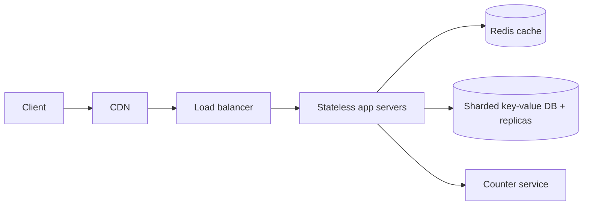

# URL Shortener - design

## Requirements

Functional: a user can shorten a long URL and gets a short link; anyone visiting the short link is redirected to the original. Optional: custom alias and expiry date. Out of scope: analytics dashboards, user accounts.
Non-functional: redirects must be fast (p99 latency under 50 ms) and highly available; created links must be durable (never lost). Scale target: 100 million new URLs per month and 10 billion redirects per month. Priority: redirect availability is the most important requirement; creation can degrade briefly.

## Estimation

Writes: 100M per month is roughly 100,000,000 / (30 x 86,400) = ~40 writes per second (QPS), peaks ~400 QPS. Reads: read-to-write ratio is 100:1, so ~4,000 redirects per second average, ~40,000 QPS at peak.
Storage: each record is about 500 bytes (code, long URL up to 400 bytes, timestamps). 100M x 500 bytes = 50 GB per month, so about 3 TB over five years - fits a single sharded database cluster.
Bandwidth: 40,000 redirects/s x 500 bytes = 20 MB/s, trivial. Cache memory: the hottest 20% of codes serve most traffic; 20% of one day of reads (~350M x 500 bytes) is under 100 GB, so a small Redis cluster holds the working set.

## Data model

Table `links` (key-value record): `short_code` (primary key, 7 chars), `long_url`, `created_at`, `expires_at`, `owner_id`. Lookup is always by short_code, there are no joins, and the workload is read-heavy, so a key-value / NoSQL store such as DynamoDB or Cassandra fits because it shards by key automatically; a relational store such as Postgres would also work at this size with a unique index on short_code.
Code generation: a 7-character base62 code gives 62^7 = 3.5 trillion values. A counter service hands out ranges of ids to each app server and each id is base62-encoded, so codes are unique with no collision checks. Random codes plus a unique-constraint retry is the alternative.

## API

`POST /v1/links` with a JSON body `{ "long_url": "...", "alias": "optional", "expires_at": "optional" }` returns 201 with `{ "short_url": "https://sho.rt/aZ3k9Qx" }`. Errors: 400 for an invalid URL, 409 if the alias is taken, 429 when the caller exceeds its rate limit.
`GET /{short_code}` returns a 302 redirect to the long URL (302 rather than 301 so browsers do not cache it and expiry works); 404 if the code is unknown and 410 if it has expired. Creation requires an API key or logged-in token; rate limit per key to stop abuse.

## Scaling

Stateless app servers sit behind a load balancer and scale out horizontally with autoscaling. A Redis cache in front of the database serves hot codes (cache-aside, TTL 24 h); a CDN can cache redirects for very popular links. The database is partitioned (sharded) by hash of short_code with consistent hashing, and each shard has read replicas. The counter service is replicated with a leader and followers.

## Bottlenecks

Hot keys: a viral link can send thousands of reads per second to one shard; mitigate with the cache, CDN and local in-process caching so a hot partition never sees the full load. The counter service is a potential single point of failure; to avoid it, run several instances each owning a separate id range. Write throughput on the database is low (400 QPS), so reads are the pressure point. We monitor cache hit ratio, p99 latency and shard CPU with dashboards and alerts.

## Failure handling

Every database shard is replicated across three availability zones with automatic failover to a standby replica, so one zone failing does not lose data. Clients and app servers use timeouts, retries with exponential backoff, and idempotent creation (the alias or a request id) so a retried POST does not create duplicates. Daily snapshots and a write-ahead log give backups for disaster recovery. If the cache is down we fall back to the database with graceful degradation (slower but correct) and shed creation traffic first. Health checks and heartbeats detect dead nodes and alert on-call.

## Trade-offs

We chose a key-value store instead of a relational database because lookups are by key only and it scales out simply; the downside is no ad-hoc queries, which we accept. Counter-based codes avoid collisions but are guessable/sequential; the alternative is random codes, which are unpredictable but need collision retries - we pick counters for simplicity and obfuscate with a shuffled alphabet. We favour availability over strong consistency for redirects: a replica may briefly lag, which is acceptable because links rarely change. Caching reduces cost and load but adds invalidation complexity; the operational overhead is worth it at 40,000 QPS. TTL and archiving cold links to cheaper storage keeps the storage cost down.
